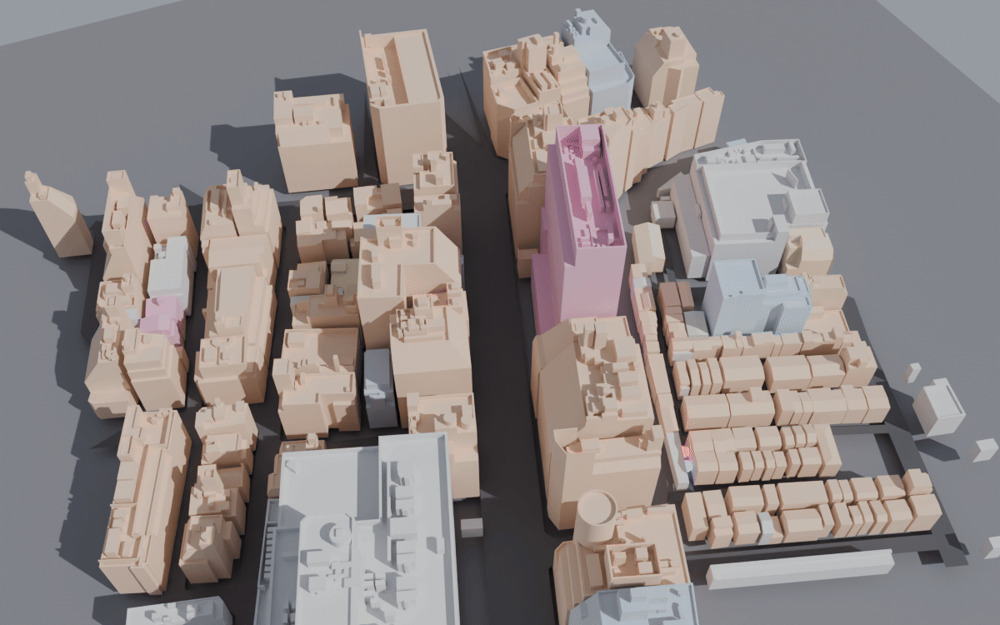
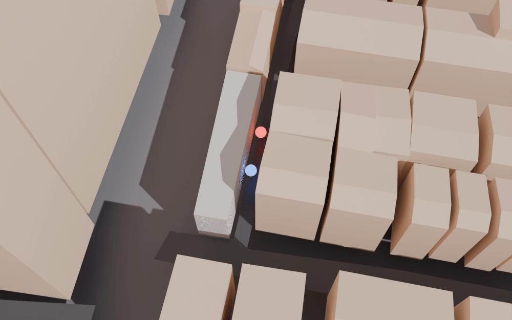

# Spike 5: PLATEAU Shinjuku → one Kabukicho chunk

**Status: done.** The measurable goal is met. FY2025 data was fetched and verified. One 1 km cell was converted with nusamai, reprojected to EPSG:6677 (checked against the GSI to 0.1 mm), re-origined Y-up and cut into a 200 m chunk. The chunk was meshopt-compressed and rendered.

Date: 2026-10-12. Machine: Ryzen 7 7700 (16 threads), shared with other spikes. All work was capped at 3 threads.

## What was done (exact versions)

| Item | Version / value |
|---|---|
| Dataset | 3D都市モデル（Project PLATEAU）新宿区（2025年度）, CityGML v5 (標準製品仕様書 第5.0版). **FY2025 exists.** CKAN created 2026-03-16, updated 2026-04-03. README dated 2026年3月13日. |
| CityGML zip | `13104_shinjuku-ku_pref_2025_citygml_1_op.zip`, 772,888,884 B. MD5 `aaa0340ace56d72404c23e163746798f` (matches the server ETag). SHA-256 `3a936966…a7282`. |
| Index map | `13104_indexmap_op.pdf`, 14.1 MB, SHA-256 `2428b8cb…5aee2a81` |
| nusamai | PLATEAU GIS Converter **v0.1.19** (tag commit `a038cff3`), built from source: `cargo build --release --locked -p nusamai -j3` |
| Own tools | `tools/plateau-chunk` (this branch): Rust 1.98.1, deps `anyhow`, `serde_json` only. No PROJ. |
| Compression | `@gltf-transform/cli` **4.5.1** (via `npx`), `meshopt --level medium` |
| Render | Blender **5.2.2 LTS**, Cycles CPU, 24 spp, 3 threads |
| Other | Node 24.21.0, ffmpeg n9.0.2, bsdtar (no `unzip` on the box) |

Pipeline (each step has a bench script in `bench/m0/spike5/`):

1. `fetch.sh` downloads the zip and the index map, checks the SHA-256 and extracts cell `53394536` (bldg, tran, frn, veg), plus `codelists/`, `metadata/`, `specification/` and `README.md`. It also counts LOD2 coverage per cell.
2. `convert.sh` runs `nusamai <gml> --sink gltf --epsg 6677 -o center_at_origin=false -t use_lod=max_lod` per layer, with `RAYON_NUM_THREADS=3`.
3. `verify-crs.sh` compares our Krüger projection with the GSI web API (`bl2xy`) and with nusamai's vertices.
4. `chunk.sh` runs `plateau-chunk chunk` on a 200 m grid square, then `gltf-transform meshopt`.
5. `render.sh` produces two headless Blender renders, palettised to 8-bit PNG, in `bench/m0/img/`.

### Licence and credit (verbatim, from the dataset README and CKAN)

URL: https://www.geospatial.jp/ckan/dataset/plateau-13104-shinjuku-ku-2025. CKAN licence field: 「PLATEAU Site Policy 「３．著作権について」に拠る」. CKAN usage permission: 「Project PLATEAUのサイトポリシーに従って、どなたでも、複製、公衆送信、翻訳・変形等の翻案等、自由に利用できます。商用利用も可能です。」

README.md (in the zip), 「利用に関する留意事項」:

> 本データセットは[PLATEAU Site Policy 「３．著作権について」](https://www.mlit.go.jp/plateau/site-policy/)で定められた以下のライセンスを採用します。
> + 政府標準利用規約（第2.0版）
> + [クリエイティブ・コモンズ・ライセンスの表示4.0国際](https://creativecommons.org/licenses/by/4.0/legalcode.ja)
> + ODC BY（https://opendatacommons.org/licenses/by/1-0/）
> + ODbL（https://opendatacommons.org/licenses/odbl/）
>
> 利用者は、いずれかのライセンスを選択し、商用利用も含め、無償で自由にご利用いただけます。
> 原典資料の位置の正しさの違いや、作成された時期の違いにより、現状を正確に反映していない場合があることにご注意ください。

The site policy (Terms of Use §3 「コンテンツの利用」) requires two things: a source credit, and a separate statement that the data was edited or processed. It also forbids presenting the result as if MLIT made it. The open data's copyright belongs to the local government (東京都). **We pick CC BY 4.0.** Credit string, embedded in every chunk's `scenes[0].extras.credit`:

> 出典：国土交通省 PLATEAU（3D都市モデル 新宿区 2025年度, https://www.geospatial.jp/ckan/dataset/plateau-13104-shinjuku-ku-2025）を加工して作成

The modification note (`extras.modifications`) reads: converted from CityGML with nusamai 0.1.19 (glTF sink, EPSG:6677, max LOD, textures dropped); clipped to this chunk; re-origined; attributes reduced; meshopt-compressed. Photo textures are not used.

## Mesh cells

Kabukicho reference point 35.6950 N, 139.7030 E → JIS 1st `5339` → 2nd `533945` → **3rd (1 km) `53394536`**. That cell spans 35.691667–35.700000 N and 139.7000–139.7125 E. PLATEAU's FY2025 Shinjuku files are **per 3rd-level mesh, not split finer**: the `bldg` cell is a single 132 MB GML.

LOD2 share per cell for the starting district (from `fetch.sh`):

| Cell | Covers | Buildings | LOD2 | Share |
|---|---|---:|---:|---:|
| 53394536 | Kabukicho, Golden Gai | 3,024 | 1,135 | 37 % |
| 53394535 | Omoide Yokocho, west side | 2,759 | 1,359 | 49 % |
| 53394526 | station east side | 1,411 | 556 | 39 % |
| 53394525 | station / south-west | 1,600 | 987 | 61 % |
| **total** | | **8,794** | **4,037** | **46 %** |

In 53394536, LOD2 is 1,134 × LOD2.2 and 1 × LOD2.0 (`uro:lodType`). There is no LOD3. The README gives district-wide figures: LOD1 57,782 buildings; LOD2.0 2,726; LOD2.2 3,774 (都市再生緊急整備地域).

## Measured numbers

Load average was 2–15 during the run, because other spikes were sharing the CPU. All runs used 3 threads unless noted.

| Step | Result | Time | loadavg (1 min) |
|---|---|---:|---:|
| Download 773 MB zip + 14 MB PDF | OK, MD5 = ETag | ~60 s | 0.4 |
| Extract one cell + codelists | bsdtar | 1 s | — |
| Build nusamai 0.1.19 | `-j3`, release | **247 s** | 0.3 → 3.1 |
| nusamai `bldg` 53394536 (132 MB GML) → GLB | 27.5 MB, 3,024 features, 451,137 verts, 243,449 tris | **0.73 s** wall (0.82 s user, 135 % CPU) | 2.2 |
| nusamai `tran` (25 MB) | 3.5 MB, 918 features | 0.2 s | 2.2 |
| nusamai `frn` (146 MB) | 29.7 MB, 4,340 features | 0.8 s | 2.2 |
| nusamai `veg` (14 MB) | **failed** (schema violation, see below) | — | — |
| `plateau-chunk chunk` (reads 3 GLBs + scans 132 MB GML) | 1 GLB | **0.20–0.27 s** (1 thread) | 4–6 |
| `gltf-transform meshopt` | | **0.46–0.67 s** incl. `npx` start-up | 4–6 |
| Blender render (1200×750, 24 spp) | overview + alley close-up | **21 s + 19 s** | 7 |

Chunk `chunk_e-11800_n-34000_s200`: EPSG:6677 E [−11800, −11600) × N [−34000, −33800), centre E −11700 / N −33900. This is central Kabukicho 1-chome, including Golden Gai.

| Chunk metric | Value |
|---|---|
| Buildings (whole buildings whose footprint-bbox centre lies in the square) | **190** |
| LOD2 vs LOD1 | **190 LOD2 (all LOD2.2) / 0 LOD1-only** (this square lies inside 都市再生緊急整備地域) |
| Roads (`tran`, clipped per triangle) | 75 features |
| City furniture (`frn`) | 0 in this square (frn only covers ~0.13 km² around Shinjuku Station) |
| Triangles | **23,328** (bldg 21,233 + tran 2,095) |
| Vertices | 42,689 (flat normals, not welded) |
| Bounds (local) | x −108…113, y 27.3…82.2 m (T.P.), z −122…109. Whole buildings overhang the square. |
| Raw GLB (f32 pos/normal, f32 feature id, u32 idx, extras) | **1,522,892 B** (gzip −9: 314,170 B) |
| meshopt GLB (KHR_mesh_quantization + EXT_meshopt_compression) | **342,416 B** (gzip −9: **207,213 B**) |
| Attributes in chunk (n = 190) | measuredHeight 190 present / **186 valid** (4 = −9999). storeysAboveGround 190 / **174 valid** (16 = 9999). usage 190 / **174 known** (16 = 461 不明). class 190. lod + lodType 190. |
| Usage mix | 402 商業施設 148, 461 不明 16, 401 業務 5, 422 文教厚生 4, 403 宿泊 3, 412 共同住宅 3, 413 店舗併用 3, 421 官公庁 3, 411 住宅 2, 431 運輸倉庫 2, 452 供給処理 1 |
| Tallest | 47.4 m |

### CRS accuracy

| Check | Result |
|---|---|
| Ours (Krüger 6th order, GRS80, zone IX, f64) vs **GSI `bl2xy` (JGD2011, zone IX)**. Points: zone origin; 35.6950/139.7030; Golden Gai 35.6941/139.7046; station east exit 35.6908/139.7006. | **0 mm** difference at all 4 points. GSI reports 0.1 mm. Kabukicho 35.6950 N 139.7030 E → E −11795.2400, N −33830.4222. |
| nusamai GLB vertices vs ours for 20,000 GML vertices of cell 53394536 | p50 **1.1 mm**, p99 1.95 mm, max **2.0 mm** (19,484 exact matches; the rest are LOD1/LOD0 rings that LOD2 replaced). This is exactly f32 quantisation of absolute coordinates about 34 km from the zone origin. |

## nusamai evaluation

**CRS options.**
- `--epsg` accepts 6697 (default, JGD2011 geographic + height), 4326/4979, 3857, JPR 6669–6687 (2D) and 10162–10174 (JPR + JGD2011 height).
- **The glTF sink only accepts JPR codes.** 6677 works, and heights stay orthometric (T.P.).
- The projection is nusamai's own pure-Rust ETMerc, which is correct, as shown above.

**glTF sink geometry.**
- It writes one GLB per feature type (e.g. `bldg_Building.glb`), with interleaved f32 POSITION/NORMAL/TEXCOORD/`_FEATURE_ID_0` and one primitive per material.
- It triangulates with earcut and gives each polygon flat normals.
- It converts Z-up to Y-up as `[E, H, −N]`.
- `center_at_origin` (default **true**) subtracts the bbox centre and **discards the offset**, so chunks can't be placed back. Use `false` and re-origin yourself.
- Positions are f32 absolute, so they carry the ≤2 mm quantisation above. The fix is a fixed-origin option, done in f64 before the f32 cast. That's a two-line patch: the matrix is already computed in f64 in `sink/gltf/mod.rs`.

**glTF sink attributes** (EXT_structural_metadata property table):
- ✔ `id`, `measuredHeight`, `storeysAboveGround`, `storeysBelowGround`, `class`, `creationDate`.
- ✔ Nested objects come through as JSON strings: `buildingDataQualityAttribute`, `genericAttribute`.
- ✘ **Every array-typed attribute is written with a broken `arrayOffsets` table**, so it can't be decoded. Affected: **`usage`**, `name`, `address`, `buildingDetailAttribute`, `buildingIDAttribute`, `keyValuePairAttribute`, `buildingDisasterRiskAttribute`. On `tran`: `function`, `usage`, `name`, `roadStructureAttribute`. On `frn`: `function`.
  - Cause: the schema says array, but scalar values are written without array offsets.
  - So **`usage` is lost in the glTF output.**
- ✘ Sentinels (−9999 height, 9999 storeys) come through as real values, not noData.
- ✘ There is no per-feature "LOD used" attribute.
- Workaround in `plateau-chunk`:
  - A single-pass line scan of the source GML (0.1 s for 132 MB) recovers `usage` (+ codelist label), `lod`, `lodType`, `measuredHeight` and storeys per `gml:id`.
  - These values take precedence. The nusamai and GML values agree on every scalar they share (0 mismatches).
- The **chunk GLB keeps a slim table in `meshes[*].extras.features`**, indexed by `_FEATURE_ID_0`:
  - Fields: id, measuredHeight, storeysAbove/Below, usage, usageLabel, class, lod, lodType.
  - It survives `gltf-transform meshopt`.
  - The full table goes to the sidecar `*.meta.json`.

**veg fails.**
- nusamai 0.1.19 aborts on the FY2025 vegetation file: `SchemaViolation("unexpected element: /core:CityModel/core:cityObjectMember/veg:PlantCover/veg:lod1MultiSolid")`.
- veg only covers ~0.13 km² near the station, so it doesn't block anything now.

## Commands to reproduce

```sh
bench/m0/spike5/fetch.sh        # download + sha256 + extract + LOD2 table
# build nusamai (once): git clone --depth 1 --branch v0.1.19 https://github.com/MIERUNE/plateau-gis-converter.git data/raw/nusamai/src
#                       (cd data/raw/nusamai/src && cargo build --release --locked -p nusamai -j3)
bench/m0/spike5/convert.sh 3    # nusamai, 3 threads
bench/m0/spike5/verify-crs.sh   # GSI + nusamai projection checks
bench/m0/spike5/chunk.sh        # cut + re-origin + meshopt  → data/build/world/chunk_e-11800_n-34000_s200{.raw,}.glb
bench/m0/spike5/render.sh 3     # bench/m0/img/chunk-kabukicho-{overview,alley}.png
```

Outputs are in `/home/akram/code/or3/data/build/world/`: `nusamai-53394536/*/*.glb`, `chunk_e-11800_n-34000_s200.raw.glb`, `.glb` (meshopt), `.meta.json` (full attributes and stats) and `.summary.json`.

Check images (committed). Buildings are coloured by usage:
- 402 commercial: warm
- 401 office: blue-grey
- 403 hotel: pink
- 411 / 412 residential: green / blue
- unknown: grey

The red and blue dots are the spike-6 source and listener.




## Failures and workarounds

| Problem | Workaround |
|---|---|
| No `unzip`, `bc` or `/usr/bin/time` on the box | `bsdtar`, shell arithmetic, `date +%s%N` |
| nusamai `center_at_origin` discards the offset | `center_at_origin=false` + our own re-origin (f32 → ≤2 mm error, acceptable for now) |
| nusamai array attributes (incl. `usage`) corrupt in glTF | GML line scan in `plateau-chunk` |
| nusamai `veg` schema violation | Skipped; veg not present in this chunk anyway |
| Arch's Blender 5.2.2 package lacks `libbf_intern_meshopt_bridge.so`, so it **can't import meshopt GLBs** | Render the uncompressed `.raw.glb`. The meshopt GLB was checked with `gltf-transform inspect`. |
| `gltf-transform` keeps `_FEATURE_ID_0` as f32 (not quantised) | Fine for now (~4 B/vertex). Pack as u16 in our own writer later, with a 4-byte-aligned stride. |

## Risks and recommendation

- **nusamai is good as a parser and projector:**
  - fast: 132 MB in 0.7 s on ~1.3 cores
  - exact projection
  - MIT-licensed
- **Its glTF sink is too thin to be our chunk writer:**
  - array attributes are broken, including `usage`
  - the origin offset is lost
  - there are no semantic surfaces (roof/wall/ground merged into one primitive), and facades and night lighting need them
  - there is no LOD tag
- **Recommendation:** keep nusamai for parsing and projection, and write our own sink in `tools/`. Two ways to do it:
  - a crate using `nusamai`, `nusamai-citygml` and `nusamai-plateau` as git deps that implements `DataSink`;
  - or extend `plateau-chunk` to read nusamai's `serde`/GeoJSON output.

  The sink should:
  - keep `bldg:RoofSurface`, `WallSurface` and `GroundSurface` as separate primitives;
  - re-origin in f64;
  - weld vertices;
  - write `usage`, `lod` and height as compact per-feature tables.

  Also send upstream bug reports or PRs for the array `arrayOffsets` bug, `center_at_origin` and `veg:lod1MultiSolid`. The current `plateau-chunk` already gives the right chunk contract (grid, origin, axes, credit, attributes), so the swap stays internal.
- **LOD2 coverage is about 46 % across the starting district.**
  - Core Kabukicho and Golden Gai squares can be 100 % LOD2.
  - Elsewhere, LOD1 boxes (with median heights) will need the procedural facade/roof treatment to blend in.
  - Budget: ~21k tris per 200 m square of dense LOD2 before facade kit and props. That's cheap.
- Size: a dense chunk is ~0.34 MB meshopt, or ~0.2 MB over gzip/brotli. A 1.5 km² district is ~40 chunks, so ~8–14 MB of base geometry. Fine.
- The f32 absolute positions from nusamai cost ≤2 mm. That's irrelevant against PLATEAU's own map-level-2500 accuracy (~±1.75 m). Still, fix it in the custom sink.

## User actions

- None blocking.
- Optional: file the three nusamai issues upstream under your GitHub account (array `arrayOffsets`, lost `center_at_origin` offset, `veg:lod1MultiSolid`). I can draft them.
- Optional: `sudo pacman -S unzip` (convenience only; bsdtar works).

## Proposed NOTES.md updates

- §9 World, **Data**: "FY2025 CityGML confirmed (CKAN 2026-03-16/04-03, 772,888,884 B, SHA-256 `3a936966…`). Files are per 3rd-level mesh (1 km). Kabukicho/Golden Gai = `53394536`; the starting district spans `53394525/26/35/36`, with LOD2 share 61/39/49/37 % (46 % overall, all LOD2.2 in the urgent-redevelopment zone)."
- §9 World, **Tooling**:
  - Replace the current line with: "nusamai 0.1.19 for parsing and projection (EPSG:6677 verified against GSI to 0.1 mm). Its glTF sink is **not** used for chunks: array attributes, including `usage`, are corrupt; the origin is lost; it has no surface semantics. Our own sink in `tools/` (`plateau-chunk` today) writes the chunks."
  - Note that `veg` FY2025 fails in nusamai 0.1.19.
- §9 World, **Streaming / chunk contract** (new): "200 m squares aligned to the EPSG:6677 grid, named by SW corner (`chunk_e<E>_n<N>_s200`). Origin at the chunk centre. x = E − E0, y = T.P. height, z = −(N − N0). Whole buildings are assigned by footprint-bbox centre; roads are clipped per triangle. A per-building attribute table lives in mesh extras, keyed by `_FEATURE_ID_0`. The PLATEAU credit and the modification note live in scene extras."
- §9 World, **Attributes**: "Sentinels −9999 (height) and 9999 (storeys) mean unknown, along with usage 461 不明. About 8 % of buildings in the Kabukicho square have them."
- §6 Offline pipeline: "Arch's Blender 5.2.2 package can't import meshopt GLBs (missing `libbf_intern_meshopt_bridge.so`). Render or inspect the uncompressed GLB."
- §16 Risks, "PLATEAU LOD2 coverage, nusamai glTF sink thin" row: change to "**confirmed**: sink thin (attributes broken), LOD2 46 % in district. Mitigation in progress: own sink."
